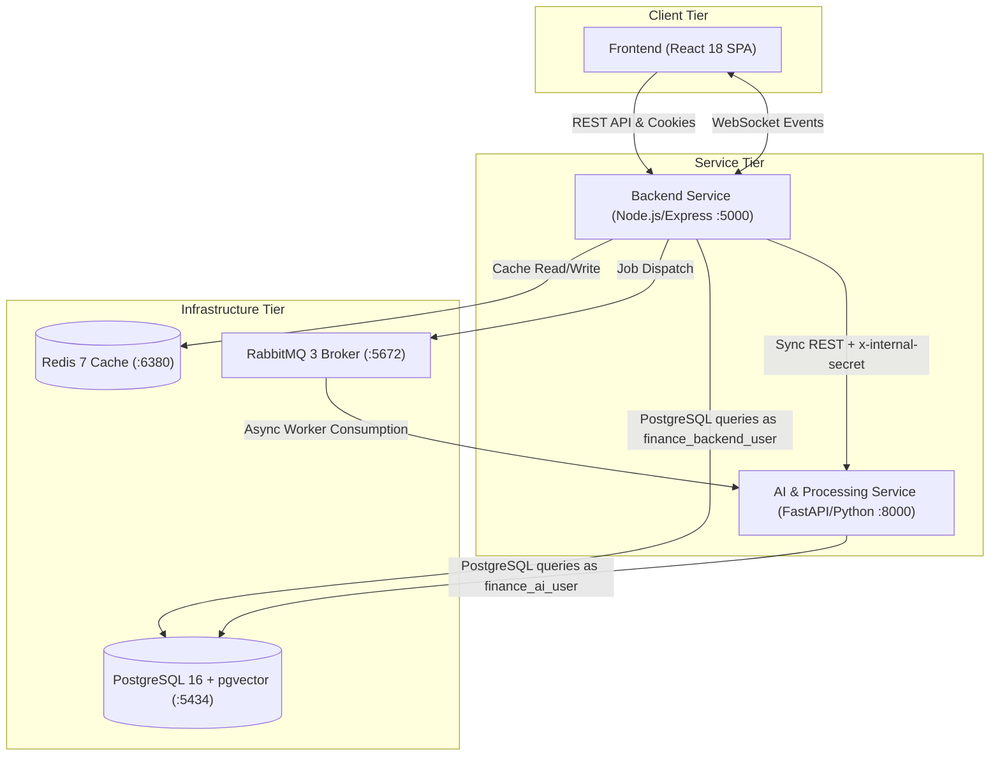
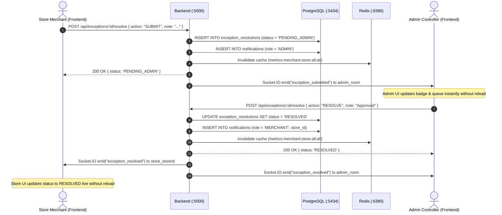

# AI Finance Controller — Service Communication & Integration Protocol (`SERVICE_COMMUNICATION.md`)

## 1. System Architecture Overview

The **AI Finance Controller** platform consists of three decoupled application tiers and an independent infrastructure layer:

---

## 2. Communication Protocols & Security Boundaries

### A. Client-to-Backend (Frontend $\leftrightarrow$ Backend)
- **Protocol:** HTTP/1.1 REST + WebSockets (Socket.IO v4).
- **Base URLs:**
  - REST: `http://localhost:5000/api` (Local) / `/api` (Production Nginx reverse proxy).
  - WebSockets: `http://localhost:5000` (Local) / `/socket.io` (Production).
- **Authentication & Session:**
  - JWT tokens encoded with Argon2id-verified user claims.
  - Transported in secure `HttpOnly`, `SameSite=Lax` cookies with fallback to `Authorization: Bearer <token>` headers.
- **WebSocket Handshake:**
  - Client passes token in `socket.handshake.auth.token` or extracts from cookie header.
  - Socket automatically joins tenant-scoped rooms upon connection:
    - `user_<user_id>` (Personal alerts).
    - `store_<store_id>` (Store-specific exception updates).
    - `admin_room` (Global admin notification broadcasts).

### B. Backend-to-AI Service (Internal Orchestration)
- **Protocol:** Internal synchronous REST over HTTP.
- **Base URL:** `http://localhost:8000` (Local) / `http://finance-ai-service:8000` (Docker).
- **Authentication:**
  - Pre-shared cryptographic secret sent via `x-internal-secret: <INTERNAL_API_SECRET>`.
  - AI Service validates secret using FastAPI dependency `verify_internal_secret`. Requests lacking this header return HTTP `403 Forbidden`.
- **Endpoints:**
  - `POST /internal/reconciliation/run`: Three-way reconciliation engine.
  - `POST /internal/tax/audit`: Section 194-O TDS and GST auditing.
  - `POST /internal/forecast/cashflow`: 7-day rolling cash flow forecasting.
  - `POST /internal/ai/query`: Gemini RAG conversational engine with pgvector fallback.
  - `POST /internal/ai/index`: Document embedding and chunk indexing.
  - `GET /internal/health`: Orchestrator health probing.

### C. Asynchronous Event Bus (RabbitMQ)
- **Broker:** RabbitMQ 3 Management running on port `5672` (AMQP) and `15672` (Management Dashboard).
- **Exchange:** `finance_events` (Type: `direct`, Durable: `true`).
- **Queues:**
  1. `reconciliation_batch_queue` (Routing Key: `reconciliation.job`).
  2. `csv_ingestion_queue` (Routing Key: `ingestion.job`).
- **Processing Pattern:**
  - Node.js backend publishes background tasks to `finance_events`.
  - Python AI Service background worker (`RabbitMQWorker`) consumes messages, triggers algorithmic reconciliation or CSV parsing, and acknowledges (`basic_ack`) completion.

### D. In-Memory Cache (Redis 7)
- **Server:** Redis 7 Alpine on host port `6380` (container port `6379`).
- **Keyspace Conventions:**
  - `metrics:<merchantId>:<storeId>:<startDate>:<endDate>`: Summary reconciliation KPIs.
  - TTL: 60 seconds.
- **Cache Invalidation:**
  - Automatically evicted via `deleteCache()` whenever an exception resolution is submitted or approved by Admin.

---

## 3. Real-Time Synchronization Workflows

### Exception Resolution Lifecycle

---

## 4. Multi-Tenant Scoping & RBAC Verification

The platform enforces strict tenant data isolation at the middleware and database layer:

1. **Merchant Scoping:**
   - Any authenticated user with `role === 'MERCHANT'` has their queries automatically constrained to `merchant_id = req.user.merchant_id` and `store_id = req.user.store_id`.
   - Attempts to access transactions, orders, bank statements, or exceptions belonging to another store or merchant are filtered out by SQL parameters (`WHERE merchant_id = $1 AND store_id = $2`), preventing cross-tenant data leaks.
2. **Admin Scoping:**
   - Authenticated users with `role === 'ADMIN'` bypass tenant filters and can view aggregate platform metrics or filter by specific merchant/store IDs via query parameters (`?merchant_id=...&store_id=...`).
3. **Database Permission Isolation:**
   - `finance_backend_user` owns user, store, session, ticket, and notification tables.
   - `finance_ai_user` owns financial transaction, order, bank statement, and vector chunk tables.
   - Cross-service writes to foreign schemas are blocked at the database engine grant level.
